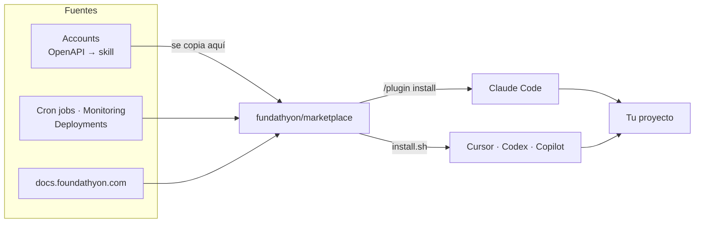
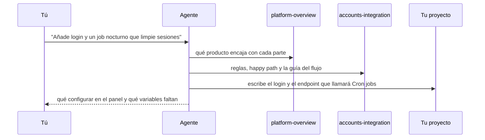

# Foundathyon marketplace

Las herramientas de IA de Foundathyon para tu agente de código. Instalas las
de los productos que usas en **Claude Code**, **Cursor**, **Codex** o
**GitHub Copilot**, y el agente los integra con sus rutas, headers y formato
de respuesta **reales**, sin inventarlos y sin que tengas que pegarle la
documentación en cada prompt.

El catálogo está segmentado: **un plugin por producto** de Foundathyon, más
**un plugin para la plataforma como conjunto**. Instalas solo lo que usas.

## Qué hay

### La plataforma

| Plugin | Skills | Qué te da | Estado | Versión |
| --- | --- | --- | --- | --- |
| `platform` | [`platform-overview`](plugins/platform/skills/platform-overview/SKILL.md) · [`platform-recipes`](plugins/platform/skills/platform-recipes/SKILL.md) | El mapa de Foundathyon: qué producto usar para cada cosa, organización, proyectos y servicios, entornos, planes y límites. Y recetas que combinan productos: un SaaS con login, crons y health checks; endpoints protegidos para Cron jobs; el camino del commit a producción | estable | 0.1.0 |

Instálalo siempre: es lo que permite al agente saber qué producto encaja y
qué plugin te falta.

### Los productos

| Producto | Plugin | Skill | Qué te da | Estado | Versión |
| --- | --- | --- | --- | --- | --- |
| **Accounts** — login y usuarios | `accounts` | [`accounts-integration`](plugins/accounts/skills/accounts-integration/SKILL.md) | Signup, signin, refresh y logout, OAuth con canje de code, magic link, código por correo, MFA, testers, webhooks, roles y RBAC, Embedded Auth, MCP Connect, bloqueo por país, cuotas y errores por `error.scope` | estable | 0.33.0 |
| **Cron jobs** — llamadas HTTP programadas | `cron-jobs` | [`cron-jobs-integration`](plugins/cron-jobs/skills/cron-jobs-integration/SKILL.md) | El endpoint que el job llama (protegido, idempotente, rápido), la configuración del job, reintentos, secretos `{{secrets.X}}` y límites del plan | preview | 0.1.0 |
| **Monitoring** — health checks y alertas | `monitoring` | [`monitoring-integration`](plugins/monitoring/skills/monitoring-integration/SKILL.md) | El endpoint de salud que conviene exponer y cómo configurar el check, sus alertas e incidentes | preview | 0.1.0 |
| **Deployments** — del commit a producción | `deployments` | [`deployments-integration`](plugins/deployments/skills/deployments-integration/SKILL.md) | CI Pipelines en `.foundathyon/pipelines`, imágenes en el Container Registry, releases por digest y estrategias de despliegue | preview | 0.1.0 |

**Estado `preview`**: el producto ya existe pero su API pública todavía
cambia. La skill dice qué está confirmado y le indica al agente qué no debe
suponer. Pasa a `stable` cuando la API se congela y la skill se genera desde
el repositorio del producto, como la de Accounts.

## Cómo funciona



Una **skill** es una carpeta con un `SKILL.md`, según el estándar abierto
[Agent Skills](https://agentskills.io). Al arrancar, el agente solo carga el
nombre y la descripción de cada skill instalada; cuando le pides algo que
encaja, abre su `SKILL.md` y, de ahí, solo la guía que necesita.



## Instalar

### Claude Code

Dentro de Claude Code (no en la terminal). El marketplace se añade una sola
vez y sirve para todos los productos:

```
/plugin marketplace add fundathyon/marketplace
/plugin install platform@foundathyon
/plugin install accounts@foundathyon
```

Añade `cron-jobs@foundathyon`, `monitoring@foundathyon` o
`deployments@foundathyon` según lo que uses. Comprueba con `/plugin list`.

Al instalar eliges el alcance: **user** (tú, en todos tus proyectos),
**project** (todo el equipo, queda en `.claude/settings.json`) o **local**
(solo tú, solo este repositorio).

Para que todo el equipo lo tenga sin instalar nada a mano, decláralo en el
`.claude/settings.json` del repositorio:

```json
{
  "extraKnownMarketplaces": {
    "foundathyon": {
      "source": { "source": "github", "repo": "fundathyon/marketplace" }
    }
  },
  "enabledPlugins": {
    "platform@foundathyon": true,
    "accounts@foundathyon": true
  }
}
```

### Cursor, Codex y GitHub Copilot

Los tres leen `~/.agents/skills/`, así que una copia sirve para todos.
[`scripts/install.sh`](scripts/install.sh) baja el marketplace y copia las
skills de los plugins que nombres:

```sh
curl -fsSL https://raw.githubusercontent.com/fundathyon/marketplace/main/scripts/install.sh \
  | sh -s -- platform accounts
```

| Quieres | Comando |
| --- | --- |
| Ver qué hay | `… \| sh -s -- --list` |
| Todos los productos | `… \| sh -s -- all` |
| Instalar en el repositorio, para el equipo | `… \| sh -s -- --dest .agents/skills platform accounts` |
| Una versión concreta | `… \| sh -s -- --ref <tag> accounts` |

Cursor también lee `.cursor/skills/` y `.claude/skills/`. Codex busca
`.agents/skills` desde el directorio actual hasta la raíz del repositorio.

Si prefieres ver lo que instalas, clona y copia:

```sh
git clone https://github.com/fundathyon/marketplace
sh marketplace/scripts/install.sh --from marketplace platform accounts
```

## Usar

Nombra el producto y el flujo. Nombrar el flujo lleva al agente directo a su
guía:

```
Integra login con email, signup y refresh token usando Foundathyon Accounts.
BASE_URL en ACCOUNTS_BASE_URL, publishable key en env.
```

```
Crea el endpoint que llamará un cron job de Foundathyon cada noche para
borrar las sesiones caducadas, protegido con un token en una cabecera.
```

```
Añade un /health a esta API para Foundathyon Monitoring y dime cómo
configurar el check.
```

```
¿Qué productos de Foundathyon necesito para un SaaS con login, emails
diarios y alertas si la API se cae? Prepara el proyecto.
```

Las credenciales van en variables de entorno, con las secret keys **solo en
el backend**:

```sh
ACCOUNTS_BASE_URL=https://foundathyon.com/services/accounts
ACCOUNTS_PUBLISHABLE_KEY=pk_live_...
ACCOUNTS_SECRET_KEY=sk_live_...        # solo backend
CRON_JOBS_TOKEN=...                    # solo backend: lo que verifica tu endpoint
```

## Actualizar

Una skill vieja genera código contra rutas que ya no existen.

**Claude Code**: `/plugin marketplace update foundathyon` y después
`/plugin update <plugin>`. El auto-update viene **desactivado** en
marketplaces de terceros: actívalo en `/plugin` → **Marketplaces** →
**foundathyon** → **Enable auto-update**.

**Cursor, Codex y Copilot**: vuelve a ejecutar `install.sh` con los mismos
plugins. Reemplaza cada carpeta entera, así que no quedan archivos viejos.

## Eliminar

```
/plugin uninstall accounts@foundathyon     # quita un plugin
/plugin disable accounts@foundathyon       # lo deja instalado, pero apagado
/plugin marketplace remove foundathyon     # quita el marketplace y sus plugins
```

En Cursor, Codex y Copilot, borra la carpeta de la skill:
`rm -rf ~/.agents/skills/accounts-integration`.

## Estructura

```text
.claude-plugin/marketplace.json        el catálogo: qué plugins hay y dónde
plugins/
  platform/                            la plataforma como conjunto (category "platform")
    skills/platform-overview/          el mapa: productos, modelo, planes, entornos
    skills/platform-recipes/           recetas que combinan productos
  accounts/                            un plugin por producto (category "integration")
    plugin.json                        manifiesto Agent Plugins (Codex, Copilot, VS Code)
    .claude-plugin/plugin.json         el mismo manifiesto, donde lo lee Claude Code
    skills/accounts-integration/
      SKILL.md                         reglas, happy path e índice
      references/                      una guía por flujo
      assets/openapi.json              el contrato HTTP
  cron-jobs/ · monitoring/ · deployments/
scripts/
  validate.py                          valida catálogo, manifiestos y skills
  install.sh                           instala skills para Cursor, Codex y Copilot
```

Reglas del catálogo, que el validador hace cumplir:

- Cada plugin es un producto (`category: "integration"`) o la plataforma
  (`category: "platform"`, solo `platform`).
- Cada skill se llama como su plugin: `<plugin>-…`.
- Un plugin tiene una sola versión, la de todas sus skills.
- `metadata.status` es `stable` o `preview`.

## Preguntas frecuentes

**¿Las skills llaman a la API?** No. Enseñan al agente a integrarla; la llama
el código que el agente escribe. Cuando un producto tenga servidor MCP,
entrará en su mismo plugin.

**¿Necesito Claude Code?** No. Cualquier agente que lea Agent Skills usa las
mismas carpetas. Claude Code es el único que las instala y actualiza con un
comando.

**¿Es seguro instalarlo?** Las skills son Markdown y un OpenAPI; no ejecutan
nada. `install.sh` solo descarga este repositorio y copia carpetas. Cada
cambio pasa por CI: el validador del estándar, el de Claude Code y el de este
repositorio.

**¿Dónde está la documentación para humanos?** En
[docs.foundathyon.com](https://docs.foundathyon.com/es/get-started/ai-tools).

---

¿Mantienes este marketplace? Las reglas para añadir un producto, versionar y
validar están en [AGENTS.md](AGENTS.md).
